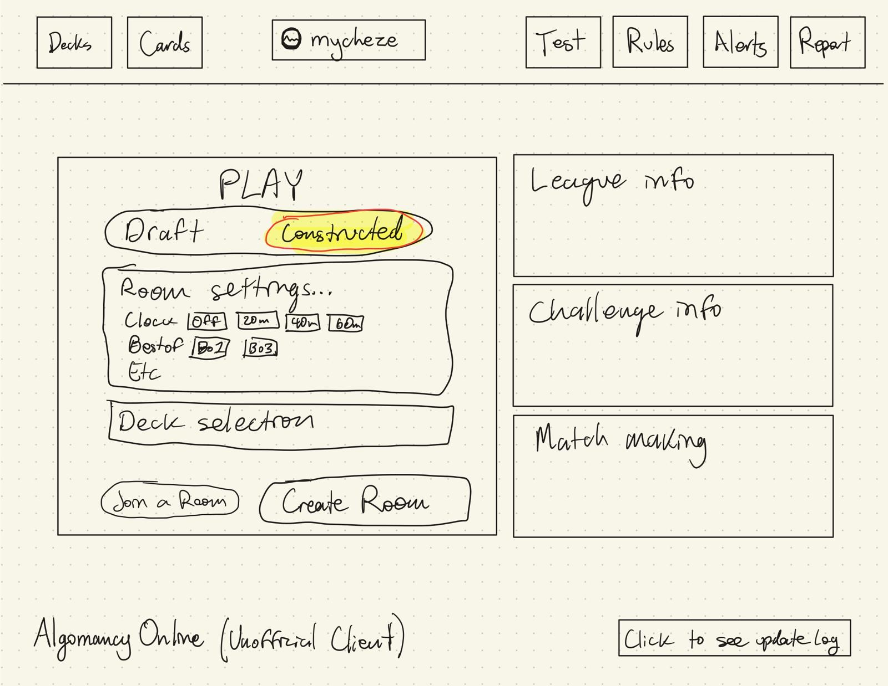

# 24: The redesign brief (owner, 2026-11-03)

> **STATUS: parked until the design-system round (docs/23) and Competitive Constructed have landed on master.**
> Owner, 2026-11-03: "save it to do once everything actually lands". This is the first brief for the
> redesign proper, the step after docs/23's Phase 5: change the look on top of the system.

The owner's words are kept close to verbatim. Where something is an interpretation, it says so.

## Principles for the whole client

1. **Works well on an iPad and a computer, with app-like design patterns.** **Mid to large screens only.**
   Owner, 2026-11-03: "Let's not even worry about phones for now. They're too small and would require an actual
   mobile UX/UI expert." The redesign targets tablet and desktop widths. Don't design phone layouts.
2. **No page scrolling.** Every page has to be manageable without scrolling up or down. An element may scroll
   inside itself where that makes sense (the card list can scroll), but never the whole page.
3. **Works full screen, and with every input pair:** taps/clicks, taps/hovers, drags/drags, and dismissing by
   tapping off, clicking off or pressing Esc.
4. **Nothing for navigation needs a keyboard.** Typing needs one, but that isn't navigation. **Everything is
   buttons.** Keyboard shortcuts are a welcome bonus.
5. **Simple, not chaotic.** "The current system just slaps boxes over boxes over boxes, rather than actually
   thinking about the UI/UX of it all." Think about the UI/UX of each screen instead.

## The home screen (sketch: `home-sketch-2026-11-03.png`)

**Top toolbar.** Big ICONS with small subtext naming the page (the sketch writes the words; they are meant to be
icons with captions):
- left: **Decks**, **Cards**
- centre: the signed-in **account** (avatar + name, e.g. "mycheze")
- right: **Test**, **Rules**, **Alerts** (the bell), **Report**

**Main area, left: the PLAY card**
- A toggle at the top: **Draft | Constructed**.
- **Room settings:** e.g. Clock (Off / 20m / 40m / 60m), Best of (Bo1 / Bo3), etc.
- **Deck selection** for constructed. For a draft room this becomes the choice of card pool: the base game or
  with expansion packs (e.g. Light & Dark). The draft's actual colours are chosen in the lobby by both players.
- A big **Create Room** button. It leads to the room screen, where you can invite friends and so on.
- A smaller **Join a Room** button. It opens a dialog to type a room code, OR accept an active invite from a
  friend, OR join a league match or a paused match.

**Main area, right: three smaller cards**
- **League:** basic information at a glance.
- **Challenge:** basic information at a glance.
- **Matchmaking:** probably a bit smaller, because nobody uses it right now.

Tapping a whole card goes deeper (opens that page).

**Bottom bar**
- Left: a bit of text, **"Algomancy Online (Unofficial Client)"**. Tapped or hovered, it brings up all the
  information about the client: the disclaimers, links to buy the game, etc. That replaces today's long legal
  footer.
- Right: **"Click to see update log"**. It opens a nice list of updates and stays out of the way otherwise,
  perhaps with a badge for "updates since your last visit". It replaces today's Recent updates band on home.

## Notes for whoever starts this (not owner decisions)
- Build it in Storybook first (`client/storybook/`), as a `pages/home` story. The page contract in
  `client/ui/pages/README.md` makes `homeHtml(view)` pure, so the new layout can be iterated there before it goes
  live.
- "No page scrolling" is a layout rule for every page, so it probably belongs in the system: an app shell (top
  bar, main area, bottom bar) with `100dvh` and per-region scrolling. Give it a guard (ui-shots can measure
  document height against the viewport at 1440, 1024 touch and 390).
- Every `data-btn` survives a redesign (tests and the tutorial find buttons by them).
